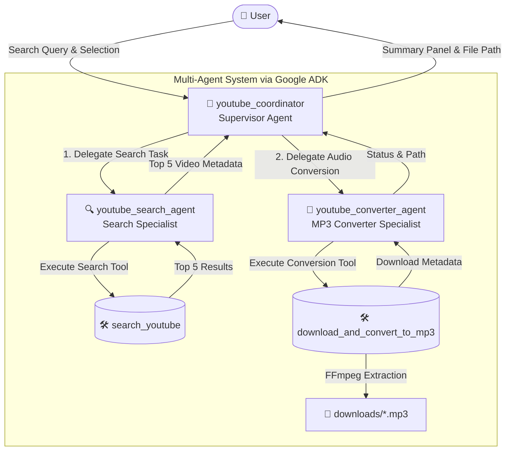

# 🎧 YouTube Multi-Agent Search & MP3 Downloader

An intelligent, multi-agent assistant built with **Google ADK (Agent Development Kit)** that accepts a search query from the user, retrieves the top 5 YouTube results with rich metadata, displays them in a clean table, and downloads/converts the chosen video into a high-quality MP3 file.

---

## 🏛️ Multi-Agent Architecture (Google ADK)

The system is built on a hierarchical multi-agent pattern using **Google ADK (`google.adk.Agent`)**:



### Agent Roles:
1. **`youtube_coordinator` (Supervisor Agent)**:
   - Root agent managing conversation state and orchestrating tasks across specialist agents.
   - Routes search queries to `youtube_search_agent`.
   - Manages video selection and delegates extraction to `youtube_converter_agent`.
2. **`youtube_search_agent` (Search Specialist)**:
   - Equipped with the `search_youtube` tool.
   - Queries YouTube, extracts the top 5 ranked results, formats titles, channel names, durations, views, and links.
3. **`youtube_converter_agent` (Audio & MP3 Specialist)**:
   - Equipped with the `download_and_convert_to_mp3` tool.
   - Extracts the highest quality audio stream and invokes FFmpeg post-processing to convert the stream into a clean 192kbps MP3 file.

---

## 🚀 Features

- **Multi-Agent Coordination**: Built natively using `google-adk` sub-agent hierarchy.
- **Top 5 YouTube Search**: Retrieves title, uploader, duration (MM:SS), view counts, and direct links.
- **Automated MP3 Conversion**: Converts YouTube streams into MP3 with built-in FFmpeg handling (`static-ffmpeg`).
- **Rich Terminal UI**: Formatted tables and download summary cards with `rich`.
- **Flexible Execution Modes**:
  - **Interactive CLI**: Search and select by number (1-5).
  - **One-Shot CLI**: Pass query and auto-download flag in a single command.
  - **Google ADK Runner**: Full conversational LLM reasoning via Gemini (`gemini-2.5-flash`).

---

## 📦 Installation & Setup

### 1. Clone & Enter Directory
```bash
cd /Users/nasunilkumar/personal/test-agent
```

### 2. Activate Virtual Environment
```bash
source .venv/bin/activate
```

*(Or install fresh with `uv` or `pip`: `pip install -r requirements.txt`)*

### 3. Configure Gemini API Key
To use autonomous LLM reasoning with Google ADK, obtain a free API key from [Google AI Studio](https://aistudio.google.com/app/api-keys):

```bash
cp .env.example .env
```
Edit `.env` and set your key:
```env
GEMINI_API_KEY="your_api_key_here"
```

> **Note**: If `GEMINI_API_KEY` is not set, the application gracefully runs in direct multi-agent pipeline mode so you can search and download immediately.

---

## 🖥️ Usage

### Interactive Mode
Run with `uv`:
```bash
uv run python main.py
```
1. Enter your search keywords (e.g. `lofi hip hop study beats`).
2. The agent displays the top 5 ranked videos in a table.
3. Choose which video (1-5) to download, or quit.
4. The audio is extracted, converted, and saved to `./downloads/`.

### One-Shot Command Line Mode
Search and automatically download the top result:
```bash
uv run python main.py --query "beethoven moonlight sonata" --auto-download 1
```

### Options & Flags
| Flag | Description | Default |
|------|-------------|---------|
| `-q`, `--query` | Search query for YouTube | Prompted interactively if omitted |
| `-d`, `--auto-download` | Auto-select and download video rank (1-5) | Prompted interactively |
| `-o`, `--output-dir` | Directory to save downloaded MP3 files | `./downloads` |
| `-m`, `--model` | Gemini model identifier | `gemini-2.5-flash` |
| `--direct` | Run deterministic multi-agent pipeline | Auto-detected |

---

## 🧪 Testing

Run the automated test suite to verify agent hierarchy instantiation, YouTube search tool, and MP3 conversion:

```bash
uv run python -m unittest test_workflow.py -v
```

All 3 tests will run and validate:
- ✅ Creation of `youtube_coordinator` with attached sub-agents.
- ✅ YouTube search retrieving 5 valid items with full metadata.
- ✅ Audio downloading and converting to a valid `.mp3` file.

---

## 📁 Project Structure

```
test-agent/
├── agents/
│   ├── __init__.py
│   ├── coordinator.py       # Google ADK Supervisor Agent
│   ├── search_agent.py      # Google ADK YouTube Search Specialist
│   └── converter_agent.py   # Google ADK MP3 Converter Specialist
├── tools/
│   ├── __init__.py
│   └── youtube_tools.py     # yt-dlp search & ffmpeg conversion tools
├── utils/
│   ├── __init__.py
│   └── formatter.py         # Rich console tables and summary cards
├── downloads/               # Output directory for converted MP3 files
├── test_workflow.py         # Automated unit test suite
├── main.py                  # CLI and interactive runner
├── .env.example             # Environment template
├── requirements.txt         # Project dependencies
├── pyproject.toml           # Project package configuration
└── README.md                # Project documentation
```
